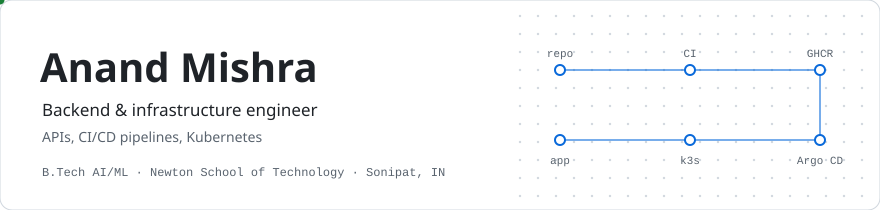
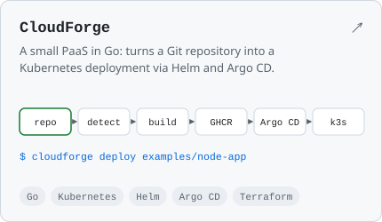
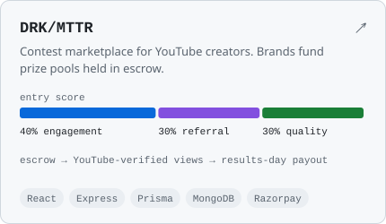
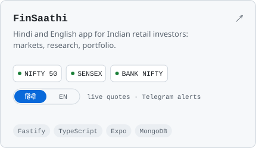
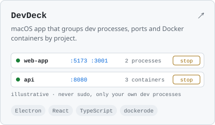
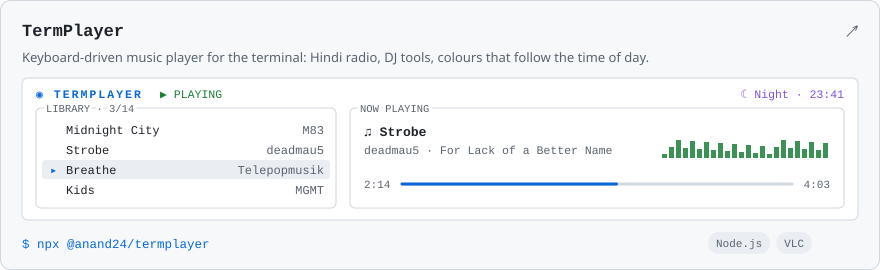
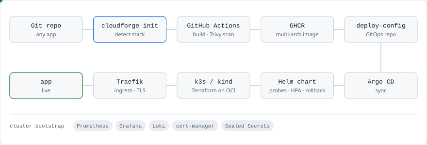
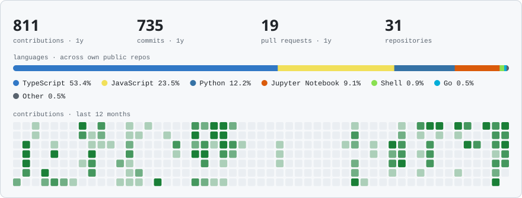

<a href="https://anandmishra.dev"><picture><source media="(prefers-color-scheme: dark)" srcset="assets/banner-dark.svg"></picture></a>

## Projects

<a href="https://github.com/anand24mishra/CloudForge"><picture><source media="(prefers-color-scheme: dark)" srcset="assets/card-cloudforge-dark.svg"></picture></a> <a href="https://github.com/anand24mishra/nanoreach-platform"><picture><source media="(prefers-color-scheme: dark)" srcset="assets/card-drk-dark.svg"></picture></a>
<a href="https://github.com/anand24mishra/FinSaathi"><picture><source media="(prefers-color-scheme: dark)" srcset="assets/card-finsaathi-dark.svg"></picture></a> <a href="https://github.com/anand24mishra/DevDeck"><picture><source media="(prefers-color-scheme: dark)" srcset="assets/card-devdeck-dark.svg"></picture></a>
<a href="https://github.com/anand24mishra/termplayer"><picture><source media="(prefers-color-scheme: dark)" srcset="assets/termplayer-dark.svg"></picture></a>

## How CloudForge ships an app

<a href="https://github.com/anand24mishra/CloudForge"><picture><source media="(prefers-color-scheme: dark)" srcset="assets/cloudforge-dark.svg"></picture></a>

## Tools

   
  

Also: Fastify · Helm · Argo CD · Traefik · Loki · Vitest · Cypress · Playwright · k6

## GitHub

<a href="https://github.com/anand24mishra?tab=repositories"><picture><source media="(prefers-color-scheme: dark)" srcset="assets/stats-dark.svg"></picture></a>

### Recent activity

<!-- LIVE-TAIL:START -->
- 2026-11-26: Pushed to anand24mishra
- 2026-11-25: Forked rajdeep-2004/dualpath
- 2026-11-24: Pushed to CloudForge
- 2026-11-24: Pushed to nanoreach-platform
- 2026-11-24: Pushed to DevDeck
- 2026-11-23: Pushed to termplayer
- 2026-11-22: Pushed to FinSaathi

Updated automatically from public GitHub activity.
<!-- LIVE-TAIL:END -->
