<div align="center">

<picture>
  <source media="(prefers-color-scheme: dark)" srcset="assets/terminal-dark.svg">
  
</picture>

<a href="https://anandmishra.dev"></a>
<a href="https://www.linkedin.com/in/anand-mishra-a3a306225"></a>
<a href="mailto:anandmishra3001@gmail.com"></a>


</div>

I build **backends that stay up** — Node/Express APIs, event pipelines on Kafka, and the Docker → Kubernetes → Helm plumbing that ships them.
B.Tech in AI/ML at **Newton School of Technology**, currently going deep on cloud-native architecture and systems that scale.

## ⎈ `anand.sys` — my stack, running

Instead of a wall of badges: here's the stack as the system I'd actually deploy. Requests flow left to right, CI/CD rolls out from the top, Prometheus keeps watch.

<picture>
  <source media="(prefers-color-scheme: dark)" srcset="assets/system-dark.svg">
  
</picture>

<details>
<summary><b>📄 <code>values.yaml</code></b> — the full manifest</summary>

```yaml
anand:
  role: backend / full-stack engineer
  location: Sonipat, Haryana, IN
  education: B.Tech AI/ML @ Newton School of Technology

  languages:  [TypeScript, JavaScript, Python, SQL]
  frontend:   [React, Next.js, Redux, Vite, Tailwind, Material UI, Three.js, Chart.js]
  backend:    [Node.js, Express, REST, Prisma, Passport.js, OAuth 2.0, JWT, Firebase]
  data:       [MongoDB, MySQL, Kafka]
  infra:      [Docker, Compose, Kubernetes, Helm, Nginx, AWS, GCP, Vercel]
  ci_cd:      [GitHub Actions]
  observability: [Prometheus]
  testing:    [Jest, Cypress, k6 load tests]

  resources:
    requests: { coffee: 2 cups/day, sleep: negotiable }
    limits:   { scope_creep: 0 }

  readinessProbe: "open to collaboration & interesting backend problems"
```

<p align="center">
  
</p>
</details>

## 📡 Live tail

<!-- LIVE-TAIL:START -->
```console
$ tail -f /var/log/anand24mishra.log
2026-11-25 21:19Z  DEBUG  fork          rajdeep-2004/dualpath
2026-11-24 20:47Z  INFO   push          CloudForge @ main
2026-11-24 19:13Z  DEBUG  star          termplayer
2026-11-24 17:49Z  INFO   push          nanoreach-platform @ main
2026-11-24 14:03Z  INFO   push          DevDeck @ main
2026-11-23 22:58Z  INFO   push          termplayer @ main
2026-11-22 23:09Z  INFO   push          FinSaathi @ main
```
<sub>auto-updated by a GitHub Action · last sync 2026-11-26 19:18 UTC</sub>
<!-- LIVE-TAIL:END -->

## 📈 Metrics

<div align="center">
  
  
</div>

## 👾 Incident response drill

Bugs are invading production. Hold the line in **[Code Defender](https://anand-242003.github.io/contact-page/game.html)** — a tiny Space-Invaders-style game I built ([source](game.html)).

<div align="center">
<sub><code>anand@prod:~$ exit 0</code> — thanks for stopping by. If something here resonates, <a href="mailto:anandmishra3001@gmail.com">say hi</a>.</sub>
</div>
